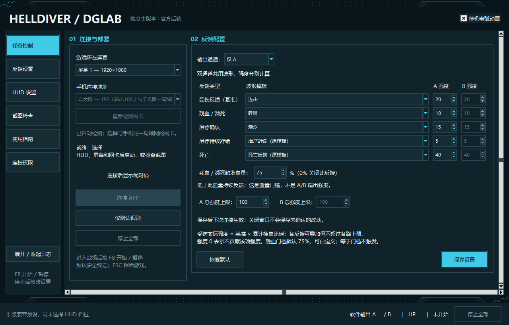
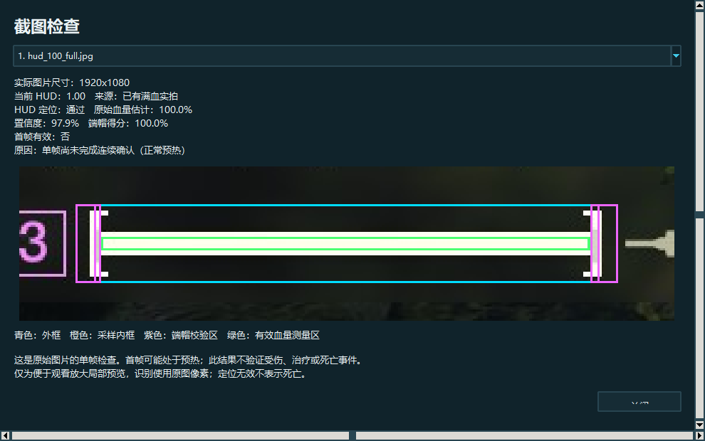
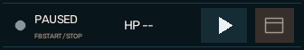

# HELLDIVER DGLAB

通过《绝地潜兵 2》的游戏画面读取自己的血量，再生成 DG-LAB 反馈。不读游戏内存，不注入游戏。

提供两种 Windows x64 软件包：**官方后端独立版**和 **DGHub 1.0.5 插件**。两版都有可调 HUD、五类反馈、独立 A/B 强度、F8、灵动岛和截图检查。

## 下载哪个版本

| 版本 | 适合谁 | 下载与说明 |
|---|---|---|
| 独立版 · v1.0.0 Beta 1 | 直接连接官方 DG-LAB APP，不需要 DGHub；遥遥领先风格主界面 | [完整 ZIP](https://github.com/wanchudao/HELLDIVER_DGLAB/releases/download/main-v1.0.0-beta.1/HELLDIVER_Main_Windows_x64_main-v1.0.0-beta.1.zip) · [发布页](https://github.com/wanchudao/HELLDIVER_DGLAB/releases/tag/main-v1.0.0-beta.1) · [指南](docs/main_official_guide.md) |
| DGHub 插件 · 1.0.5 | 已经使用 DGHub，让宿主管理 APP、设备和波形库 | [完整插件 ZIP](https://github.com/wanchudao/HELLDIVER_DGLAB/releases/download/dghub-v1.0.5/HELLDIVER_DGHub_Windows_x64_dghub-v1.0.5.zip) · [发布页](https://github.com/wanchudao/HELLDIVER_DGLAB/releases/tag/dghub-v1.0.5) · [指南](docs/dghub_plugin_guide.md) |

下载 Release 附件中的完整 ZIP；GitHub 自动生成的 **Source code** 是开发源码。两版运行库均随包，普通用户无需另装 Python、Node、OpenCV 或抓屏库。DGHub 版需要 **DGHub 1.9.6、外部插件 SDK v1**；独立版包含自己的官方 SOCKET 后端。

本仓库提供公开测试版下载。DGHub 官网投稿尚未完成，GitHub 发布不代表已获插件市场审核。

## DGHub 插件怎么用

1. 下载上表的 **DGHub 1.0.5 完整插件 ZIP**，在 DGHub 插件中心导入。ZIP 内的 `manifest.json`、`helldiver_dglab.exe` 和 `_internal` 已齐全，直接由 DGHub 导入。
2. 游戏使用 **1920×1080**，完整铺满所选屏幕，建议无边框全屏。在插件配置中选择正确的显示器编号和与游戏相同的 HUD 档位。
3. 设置仅 A、仅 B 或 A+B，以及五类反馈的波形、强度和各通道上限。将本插件的待机强度设为 **0**，保持“允许输出”保险打开。
4. 启用插件，等待启动检查就绪。每次启用默认暂停；在地面战场按 **F8**，或点击浮窗／灵动岛按钮开始，再次操作暂停。停用插件或关闭控制面板结束会话。
5. 暂停后点击 **CHECK** 检查本地原始截图，点击 **GUIDE** 查看完整指南。没有设备时可以识别血量，显示 `VISION ONLY`，A/B 请求为 0；实际反馈需先在 DGHub 中连接 APP 和设备。

“允许输出”是保险开关，重新打开后仍需 F8／浮窗启动。HUD、波形、强度、通道及残血门槛的修改在**停用后重新启用**生效，F8 暂停／恢复保持当前会话配置。设备接入或断开也会暂停，重新确认后才能输出。F8 被占用时显示 `F8 UNAVAILABLE`，可使用浮窗按钮。

DGHub 插件使用原有控制窗／灵动岛，遥遥领先风格主界面属于独立版。完整流程及故障排查见 [插件指南](docs/dghub_plugin_guide.md)。

## 独立版怎么用

完整解压独立版 ZIP，双击 `HELLDIVER_Main.exe`，保留同目录的 `_internal`。



1. 先关闭旧版本，完整解压新包。不要同时运行多个输出版本。
2. 游戏使用 **1920×1080**，完整铺满选中的屏幕，建议无边框全屏。
3. 在软件 **HUD 设置**中选择游戏相同的 HUD 大小，保存。
4. 可先用 **截图检查**读取原始截图，无需连接 APP；或点 **仅测试识别**，在游戏里测试实时血量。
5. 要连接时，选择与手机同一局域网的电脑地址，点击 **连接 APP**，在官方 DG-LAB APP 的 SOCKET 入口扫描新二维码。
6. 进入地面战场后按 **F8** 开始，再按 F8 暂停。结束时点击 **停止全部**。

初始状态是暂停，不会自动开启反馈。F8 暂停保留本次配对，但不解锁设置；停止全部后才能改设置，保存的设置在下次会话生效。

## 有哪些反馈

| 反馈 | 触发规则 | 独立版默认波形 | DGHub 默认波形 | 默认 A／B 基准 |
|---|---|---|---|---|
| 受伤 | 0.2 秒内累计掉血，强度随伤害量变化 | 连击 | 连击 | 20／20 |
| 残血／濒死 | 有效血量大于 0 且低于所选门槛，持续反馈 | 呼吸 | 呼吸 | 10／10 |
| 治疗确认 | 检测到有效回血 | 潮汐 | 潮汐 | 15／15 |
| 治疗持续舒缓 | 回血期间持续，最近一次回血后默认继续 2 秒 | 原治疗模板 | 心跳节奏 | 5／5 |
| 死亡 | 连续有效血量从正数到零，每条生命只触发一次，默认 5 秒 | 原死亡模板 | CS2-死亡 | 40／40 |

- 残血门槛可设 **0–100% 的整数**，默认 75%。等于门槛不触发；0% 仅关闭残血层，不关闭受伤、治疗或死亡；100% 在满血时不触发。
- 受伤／治疗确认默认持续 2 秒，死亡默认持续 5 秒。波形优先级为死亡 ＞ 治疗确认 ＞ 受伤 ＞ 治疗舒缓 ＞ 残血。
- 支持仅 A、仅 B、A+B；双路共用波形和节奏，强度及总上限分别计算。默认仅 A。
- 独立版内置 18 个波形选项，含官方 16 组 V3 示例和原治疗／死亡模板；DGHub 插件从宿主波形库选择，启动时校验所选预设，按完整周期播放。
- 无有效 HUD、失帧、暂停、断线或退出会停止反馈并清空识别基线，不把识别失败当成死亡。

软件界面的 A/B 是**软件输出／插件请求**，APP 的上限、实际显示和体感不一定与设置值相同。独立版主窗口状态超过一秒未更新时显示未知。DGHub 多插件在每通道取最大强度层，停用本插件不代表其他插件也停止。

DGHub 版的短时强度请求会产生宿主事件卡片，可能触发高强度音效。暂停／停止申请本插件层归零并停止续发；SDK v1 没有设备波形缓存清空确认。具体说明见 [插件指南](docs/dghub_plugin_guide.md#强度与故障排查)。

## HUD、截图检查和灵动岛

HUD 提供 **0.75–1.25，每档 +0.05，共 11 档**，不允许输入任意值。这里是游戏 HUD 大小，不是分辨率或 Windows 缩放。

- 0.75、0.80、0.85、0.90、0.95、1.00、1.25：已有满血实拍支持定位。
- 1.05、1.10、1.15、1.20：插值推算，有合成几何回归，尚未补齐实拍。
- 选错档、尺寸不符、遮挡或定位歧义会拒识，显示 `NO HUD / HP --`。不会自动换档或偷偷缩放原图。
- 独立版旧安装没保存新 HUD 设置时保留旧兼容预设；DGHub 版默认选择 1.00，使用前请与游戏设置核对。

截图检查显示原图尺寸、放大的血条、端帽与测量框、原始血量及拒识原因。**单张图片只能测定位和单帧血量，不代表事件或设备反馈通过。**



控制窗的 `ISLAND [-]` 可折叠成顶部灵动岛，折叠／展开不重新连接、不改变启停状态。悬停不展开或启动，窗口使用不激活置顶处理。游戏独占全屏下不保证可见，实际焦点表现需按游戏环境检查。



主窗口采用深蓝黑、青蓝、冷白、电路花纹和少量电弧。待机动画可关闭；会话启动后（包括 F8 暂停）停止动画，设置页、控制窗和灵动岛始终静态。

## 系统条件、依赖和连接权限

- 两种软件包均为 **Windows x64**；本机 Windows 11 已验证。其他系统没有本轮成品。
- Python、图像库、抓屏及主要 C++ 运行库随包；独立版另带 Node，DGHub 版另需安装宿主 1.9.6。软件仍使用 Windows 自带组件，Windows N／删减版缺少媒体组件时可能需要 [Media Feature Pack](https://support.microsoft.com/en-us/windows/media-feature-pack-for-windows-10-11-n-february-2023-2aaf89b8-f9d3-4322-98d0-612c9bea9c01)。没有完成所有干净系统的兼容验收。
- 新 HUD 模式仅支持完整 **1920×1080** 的现有布局；其他分辨率、HUD 布局和窗口留边不在本次新增适配范围内。
- 截图检查不需要 APP 或设备。独立版连接官方 APP 时，手机与电脑需在同一可信局域网；DGHub 版由宿主负责配对和设备连接，插件随包依赖完整，投稿“依赖资源”可留空。
- 独立版**平时不用管理员运行**。需要放行时，停止全部 → 连接权限 → 一键配置连接权限，阅读范围并明确确认后才请求管理员授权；可取消或撤销。
- 权限仅针对本包 `_internal/runtime/node.exe`，专用网络、本地子网 TCP 入站。不关闭防火墙、不开放公用网络、不做公网映射。指南显示实际后端路径。

连接失败不一定是权限问题，也可能是网卡选择、访客隔离或网络策略。移动软件目录会改变后端路径，旧放行规则不一定继续适用。

## 测试范围和已知限制

- 独立版：2026-10-10 记录 **2023 项 Python、16 项后端测试通过**；最终 EXE 的模拟 APP、双路停止、门槛链路、截图诊断、77 次实拍 HUD 交叉检查及桌面灵动岛检查通过。用户反馈连接和使用正常。
- DGHub 1.0.5：2026-10-10 门槛功能回归 **1992 项通过**；最终 EXE 的 10 个软件协议场景、77 次 HUD 实拍交叉检查、正常入口及冻结停止检查通过。隔离原生 DGHub 验证了导入、配置保存、101 个门槛值和停用／启用后的生效规则。
- 本次 GitHub 发布复核原成品的清单、运行文件哈希和验收报告；补充公开说明与许可证。详见 [DGHub 发布说明](docs/releases/dghub-v1.0.5.md)。
- 四个插值 HUD 档、不同物理显示器／Windows 缩放、更多电脑和长时间游戏仍需实际测试。四档 Tk 逻辑布局模拟不等于四档真实系统缩放验收。
- 未完成实体设备全面验收，不声称绝对安全、零 BUG 或 100% 识别准确。

独立版详见 [开发验收记录](docs/main_ui_acceptance_20261010.md) 和 [发布说明](docs/releases/main-v1.0.0-beta.1.md)；DGHub 详见 [发布说明](docs/releases/dghub-v1.0.5.md) 和包内 `acceptance/`。1.0.5 的新门槛控件原生界面点击、真实游戏、手机和实体设备验收仍待完成；1.0.4 的桌面 F8 记录不代替新版游戏内验证。

## 更新、设置和日志

独立版：先停止并退出旧版、备份整个旧目录。要保留防火墙的后端路径，在**相同位置完整升级** EXE 和 `_internal`，保留 `feedback_settings.ini`、`hud_settings.ini`、`ui_settings.ini`、`sessions` 和日志。

独立版回退使用完整旧备份及对应配置。更早的版本可能拒绝新增 `[trigger]`，必须同时恢复升级前反馈配置。操作详见 [升级与测试](docs/main_ui_upgrade_20261010.md)。

DGHub 版：先停用插件，备份旧完整包及该插件在宿主中的配置，再导入新 ZIP。插件 ID 保持 `helldiver_dglab`，设置由 DGHub 保存；会话日志存于 `%LOCALAPPDATA%/HELLDIVER_DGLAB/DGHub/helldiver_dglab-<安装路径标识>/sessions/`。**回退到 1.0.4 时必须同时恢复升级前该插件配置**，旧版会拒绝新增的门槛字段。详细步骤见 [插件指南](docs/dghub_plugin_guide.md)。

公开软件包不包含个人配置、会话日志或备份。

报告问题时请注明软件版本、HUD 档位、分辨率、操作步骤和错误文字，可附原始截图及相关日志；发日志前移除私人信息。不要提交访问令牌、个人配置或完整备份。[提交问题](https://github.com/wanchudao/HELLDIVER_DGLAB/issues/new)

## 源码与构建

普通用户只需下载完整软件包。开发者参见 [独立版构建](docs/build_main.md) 和 [DGHub 插件构建](docs/build_dghub.md)。主要目录：

```text
src/                  识别、反馈、连接与独立版界面
tools/desktop_app.py  独立版入口
main_desktop.spec     Windows 软件包构建配置
packaging/backend/   随包后端依赖清单
official_v2/         官方 SOCKET 后端适配
tests/                自动回归
docs/                 使用、验收和来源说明
dghub_plugin/         DGHub SDK 会话、输出、控制窗和配置生成
tools/dghub_live_entry.py  当前 DGHub 插件入口
dghub_live.spec       DGHub 完整运行包构建配置
```

当前 DGHub 清单由 `dghub_plugin/sdk_config.py` 生成。目录中的旧离线 `manifest.json` 和早期预览说明用于历史开发记录；可导入的 1.0.5 清单位于完整 Release ZIP 根目录。

## 来源与声明

本项目是非官方社区工具，不隶属或代表 Arrowhead、PlayStation／Sony 或 DG-LAB。界面采用原创代码绘制的装饰，没有将游戏债券封面或官方标志直接用作软件背景。

官方后端／波形来源及原仓库的非商业用途声明见 [波形来源](docs/waveform_sources.md)。随包第三方运行库有各自许可证，见 [第三方说明](docs/third_party_notices.md) 和软件包中的 `LICENSES`。公开源码不意味着取得游戏素材、商标或第三方内容的额外商业授权；不要把整包视作统一 MIT 许可。
